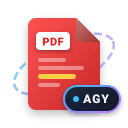

<p align="center">
  
</p>

<h1 align="center">📄 PDF Reviewer for Antigravity (AGY) 2.0</h1>

<p align="center">
  <b>Give Antigravity the superpower to read, write, modify, and delete PDF comments directly.</b><br>
  An official Antigravity 2.0 UI plugin, live sidecar, and MCP tool suite that renders compiled PDFs live inside the <b>Right-Hand Auxiliary Pane</b> with automatic hot-reloading and empowers agents to perform full CRUD operations on native ISO 32000 PDF annotations.
</p>

<p align="center">
  <a href="https://github.com/axiomfab/pdf-reviewer"><b>Repository</b>: github.com/axiomfab/pdf-reviewer</a>
</p>

---

> [!NOTE]
> ### 🎨 100% Heavily Vibe Coded
> This plugin is **heavily vibe coded**. Built through fast, fluid pair programming sessions with Antigravity agents, it prioritizes immediate developer ergonomics, rapid iteration, and direct agent autonomy over enterprise ceremonial overhead. It works, it's fast, and the vibes are immaculate. Community contributions—whether authored by humans or AI agents—are highly appreciated!

---

## ⚡ Core Agent Capabilities: Full CRUD on PDF Comments

PDF Reviewer bridges the gap between compiled documents and autonomous AI pair programmers by giving Antigravity native Model Context Protocol (MCP) tools to interact with PDF comments:

* 📖 **Read Comments (`mcp_pdf_annotations_list`)**: Antigravity inspects user feedback, extracts highlighted phrases, sticky notes, and diagram coordinates across the entire document or on a specific page.
* ✍️ **Write Comments (`mcp_pdf_annotations_add`)**: Antigravity programmatically embeds native ISO 32000 annotations into the PDF—attaching review notes, citations, proposed replacements (`strike`), or bounding boxes (`area`).
* ✏️ **Modify Comments (`mcp_pdf_annotations_modify`)**: Antigravity updates existing comment text, changes status (e.g. marking comments as `resolved`), or appends clarification replies without altering document geometry.
* 🗑️ **Delete Comments (`mcp_pdf_annotations_delete` & `clear`)**: Antigravity purges resolved review comments by ID once underlying code/LaTeX has been fixed, or clears all annotations upon final approval.

---

## 🔄 The Closed-Loop LaTeX & Document Workflow

When writing academic papers, reports, or documentation in LaTeX (or Typst) with Antigravity agents, context-switching between external PDF viewers and copying feedback back into chat breaks flow. PDF Reviewer eliminates that friction:

1. **You ask Gemini to write or edit your LaTeX.** Your background compiler (`pdflatex`, `latexmk`, `typst watch`) rebuilds the document, which refreshes automatically in the right-hand auxiliary side panel without losing scroll or zoom position.
2. **You review visually.** Directly on the rendered PDF, highlight awkward phrasing or box a misaligned table/equation and attach your review comment (e.g., *"rephrase this claim"*, *"table is overflowing margin"*, *"check equation 3"*).
3. **Gemini reads & fixes directly.** Instead of copying text into chat or describing coordinates, you simply tell Gemini: *"Address the annotations on page 2 and mark them resolved"*. Gemini uses `mcp_pdf_annotations_list` to read the comments, fixes the underlying `.tex` code, calls `mcp_pdf_annotations_modify` or `mcp_pdf_annotations_delete`, and the panel re-renders the corrected output.

---

## 📦 Installation

### Quick Install (Antigravity CLI)
Run the following command in your terminal:
```bash
agy plugin install https://github.com/axiomfab/pdf-reviewer
```
Then install dependencies in the plugin directory:
```bash
cd ~/.gemini/config/plugins/pdf-reviewer && npm install
```

### Manual Install
Clone the repository directly into your Antigravity plugins directory:
```bash
git clone https://github.com/axiomfab/pdf-reviewer.git ~/.gemini/config/plugins/pdf-reviewer
cd ~/.gemini/config/plugins/pdf-reviewer
npm install
```
*Note: Restart your Antigravity session or reload the window after installation to discover the newly mounted plugin.*

---

## 🚀 Key Features

* **Complete PDF Comment CRUD**: Native toolset for reading, writing, modifying, and deleting annotations.
* **Embedded Auxiliary View**: Renders directly inside the Antigravity 2.0 auxiliary side panel (`SIDECAR_UI_ENTRYPOINT_AUX_PANE`).
* **Instant Hot-Reload**: Automatically detects workspace file changes (e.g. from `pdflatex`, `typst watch`, or `marp`) and refreshes seamlessly without losing your current zoom or scroll position.
* **Interactive UI Reviewing**:
  * 🔤 **Text Comments**: Highlight text spans and attach comments.
  * ✂️ **Area Snip**: Box diagrams, math equations, or charts with custom comments.
* **Zero Heavy Dependencies**: Built purely with `pdf-lib` for robust vector PDF manipulation and Node.js standard libraries for stdio JSON-RPC.
* **Multi-Document Scanner**: Automatically finds PDF documents across project workspaces (root, `build/`, `output/`) with a one-click dropdown switcher.

---

## 🛠️ Usage

### 1. Sidecar UI
Launch or open the PDF Reviewer from any Antigravity chat session using the sidecar link:
```markdown
[PDF Reviewer](sidecar://pdf-reviewer/panel/)
```

### 2. Native MCP Tool Suite
The plugin registers a local stdio MCP server exposing 5 core tools to the agent:

| MCP Tool | Operation | Description | Key Arguments |
| :--- | :--- | :--- | :--- |
| **`mcp_pdf_annotations_list`** | **Read** | Extract all ISO 32000 annotations (`/Highlight`, `/Text`, `/Square`, `/Stamp`, etc.) | `{ pdfPath: string, page?: number }` |
| **`mcp_pdf_annotations_add`** | **Write** | Programmatically embed an annotation, note, or area box into the PDF | `{ pdfPath, page, type, comment, selectedText?, rect? }` |
| **`mcp_pdf_annotations_modify`** | **Modify** | Update existing comment content, author, or status (e.g. `resolved`) | `{ pdfPath: string, commentId: string, comment?, status? }` |
| **`mcp_pdf_annotations_delete`** | **Delete** | Remove a specific resolved annotation by ID | `{ pdfPath: string, commentId: string }` |
| **`mcp_pdf_annotations_clear`** | **Delete All** | Clear all annotations from a target PDF once addressed | `{ pdfPath: string }` |

### 3. Terminal CLI Fallback
You can also run headless annotation management straight from your terminal:
```bash
# List all annotations (Read)
node sidecars/panel/pdf_annotations.mjs list <path-to-pdf>

# Modify an annotation (Update)
node sidecars/panel/pdf_annotations.mjs modify <path-to-pdf> <commentId> --status=resolved

# Delete a specific annotation (Delete)
node sidecars/panel/pdf_annotations.mjs delete <path-to-pdf> <commentId>

# Clear all annotations (Clear)
node sidecars/panel/pdf_annotations.mjs clear <path-to-pdf>
```

---

## 🧪 Testing

The plugin includes unit test coverage for PDF scanning, ISO 32000 annotation lifecycle, error handling, and MCP JSON-RPC protocol compliance:

```bash
npm test
```

---

## 📄 License

MIT © [axiomfab](https://github.com/axiomfab)
